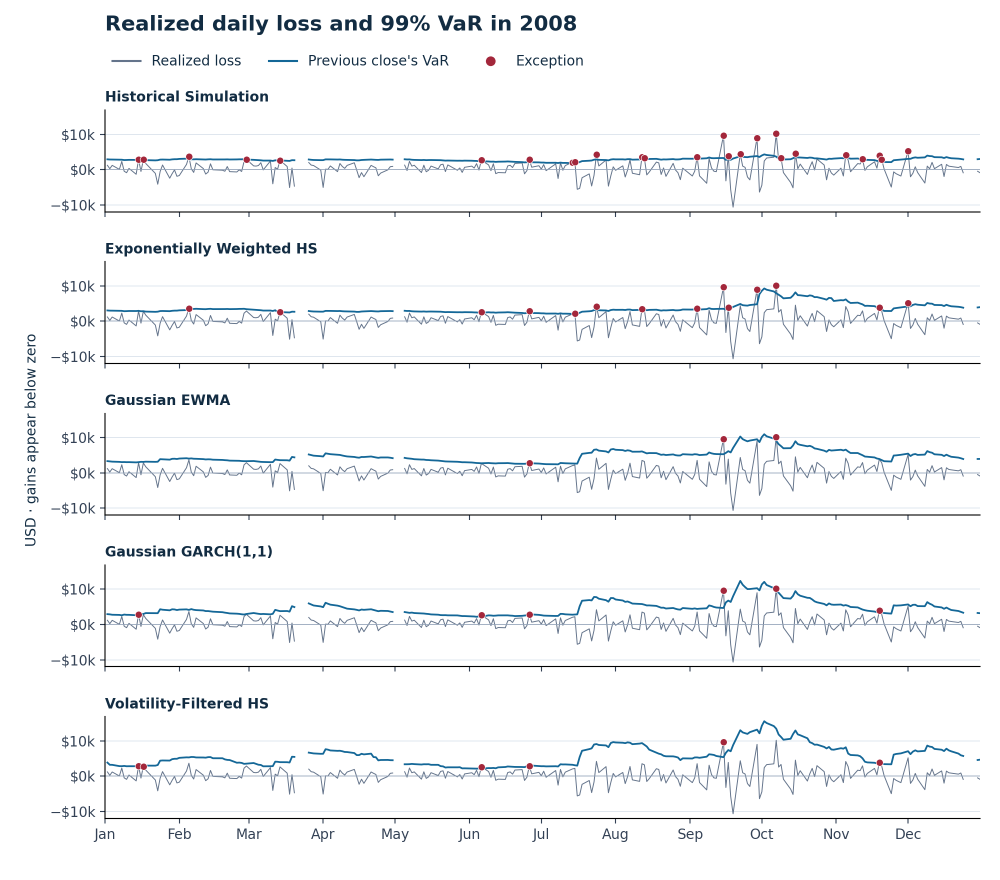

# Bank Equity Under Stress — Backtesting Portfolio VaR in 2008

How well could a risk desk forecast tomorrow's 99% loss threshold for a ten-bank equity portfolio during the financial crisis? Which positions drove the worst losses?

- **Gaussian EWMA breached on 3 of 247 sessions**, versus 2.47 expected. It had the lowest mean quantile loss ($68.41) at a mean VaR of $4,733. Historical simulation breached 25 times.
- **All five models missed September 15.** The book lost $9,664 against EWMA's $5,279 threshold. Bank of America alone contributed $7,147 of losses.
- **October 7 was worse in dollars.** The book lost $10,168. Only volatility-filtered historical simulation covered it, with a $13,463 threshold.



[Research report](report/research_report.md) · [PDF](report/research_report.pdf) · [Model comparison CSV](results/model_summary.csv) · [Daily backtest CSV](results/daily_backtest.csv)

## Read the analysis

| Notebook | What it does |
| --- | --- |
| [01 · Data](01_data.ipynb) | Downloads historical closes and exchange rates, verifies security identities and checks gaps and corporate actions. |
| [02 · Portfolio](02_portfolio.ipynb) | Fits minimum-variance weights on 2006 returns, invests $100,000 in January 2007 and holds fixed shares. |
| [03 · VaR and backtest](03_var_backtest.ipynb) | Builds five previous-close forecasts, checks timing and explains the three largest dollar losses. |

[Data coverage](results/data_coverage.csv) · [Weights](results/allocation.csv) · [Worst-day attribution](results/worst_day_attribution.csv)

## Reproduce

Python 3.13 was used for the saved run. The first notebook needs a WRDS account with access to CRSP US Stock, Compustat Global Security Daily and Compustat North America Security Daily. It also downloads the public ECB EUR/USD reference series. The download is cached in `data/private/`. The notebooks can rerun from that cache without a WRDS connection.

Set up your local [PostgreSQL password file](https://www.postgresql.org/docs/current/libpq-pgpass.html) for the WRDS host `wrds-pgdata.wharton.upenn.edu`, port `9737` and database `wrds`. Keep the file outside the repository with owner-only permissions. Replace `your_wrds_username` with your username. The password file is optional when running notebook 01 interactively, where the kernel can prompt for the password.

```bash
git clone https://github.com/MartinXQD/bank-equity-var-backtesting-2008.git
cd bank-equity-var-backtesting-2008
python3.13 -m venv .venv
source .venv/bin/activate
python -m pip install -r requirements.txt
python -m ipykernel install --prefix "$VIRTUAL_ENV" --name bank-var
export WRDS_USERNAME=your_wrds_username

python -m nbconvert --to notebook --execute --inplace \
  --ExecutePreprocessor.kernel_name=bank-var --ExecutePreprocessor.timeout=240 \
  01_data.ipynb 02_portfolio.ipynb 03_var_backtest.ipynb &&
python report/render_pdf.py
```

The notebooks recalculate the CSVs and figures from the source data. The PDF renderer uses the checked-in Markdown narrative and tables with the regenerated figures. If refreshing a revised vendor dataset changes results, update the narrative and tables before regenerating the PDF. Set `BANK_VAR_REFRESH=1` for a fresh download.

## Conventions

The portfolio values nine NYSE securities and BNP Paribas's Paris-listed share, converted from EUR at the same day's ECB reference rate. Prices are split-adjusted and exclude cash dividends, costs and financing. A usable daily P&L requires all ten marks at both ends of a single NYSE session interval. Six 2008 intervals were excluded under that rule.

Calculated from historical CRSP US Stock Database and S&P Global Market Intelligence Compustat data accessed through WRDS, and ECB exchange rates. The cache contains licensed security data and is excluded from Git. Readers can inspect the report and research results without a data subscription.
