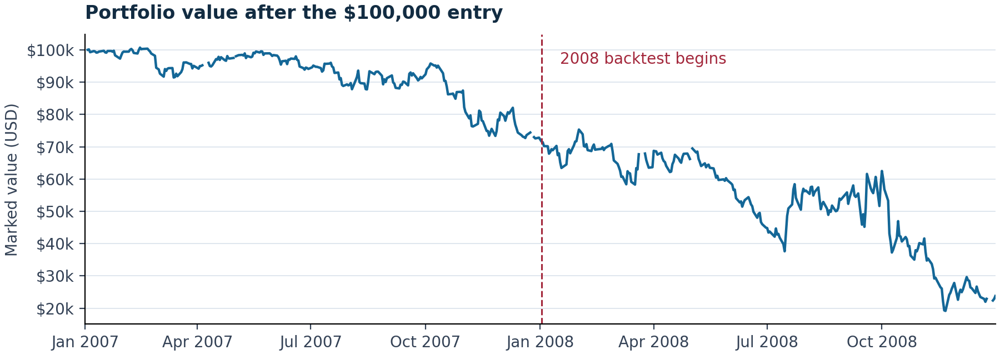
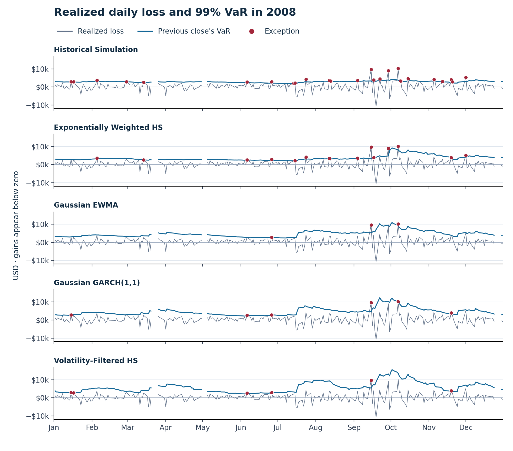
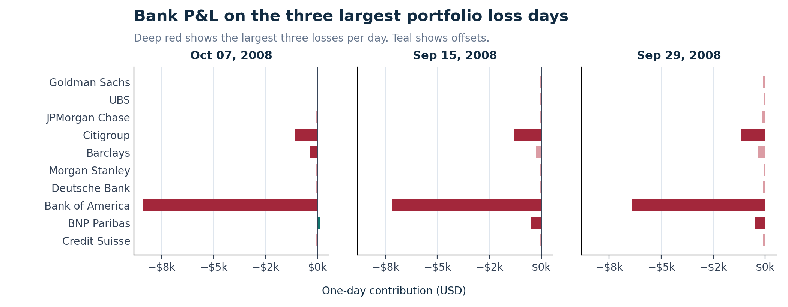

# Bank Equity Under Stress — Backtesting Portfolio VaR in 2008

**Qidian (Martin) Xing · Market risk research · November 2026**

I would report **Gaussian EWMA** as the daily 99% VaR for this portfolio and review a separate concentration stress alongside it. EWMA recorded **3 exceptions in 247 sessions** against 2.47 expected. Its mean threshold of **$4,733** was close to GARCH's and below the filtered historical model's. It had the lowest mean quantile loss of the five.

The largest error shows why the desk still needs a stress view. On September 15, the portfolio lost **$9,664** against EWMA's **$5,279** forecast. Bank of America alone lost **$7,147** on a $33,539 position. A portfolio VaR number can miss both the abrupt repricing and the concentration behind it.

## The position entering the crisis

Figure 1. The fixed-share portfolio fell from $100,000 at entry to $23,771 at year-end 2008. The dashed line marks the first scored session.

A long-only minimum-variance allocation with a 1% weight floor put **53.0% in Bank of America** and **27.1% in Citigroup**. The optimized daily volatility on the 245 complete 2006 observations was 0.747%, versus 0.956% for equal weights on the same sample. The resulting two-name concentration is central to the loss attribution.

The desk puts $100,000 to work at the close on January 3, 2007, and holds fixed entry-date-equivalent shares through 2008. The 244 usable 2007 returns initialize the models during a year when market pressure was already building. The backtest scores one-session USD P&L from January 2 through December 31, 2008.

<!-- pagebreak -->

## How the models handled 2008

**Table 1.** All five models use the same 247 sessions and 2.47 expected exceptions. Excess statistics use exception days only. Quantile loss charges 99 cents per dollar of undershoot and 1 cent per dollar of overshoot. Smaller is better.

| Model | Exceptions | Rate | Mean VaR | Mean excess | Max excess | Quantile loss |
| --- | ---: | ---: | ---: | ---: | ---: | ---: |
| Historical simulation | 25 | 10.12% | $2,824 | $1,249 | $6,518 | $152.57 |
| Exp. weighted HS | 14 | 5.67% | $3,613 | $1,210 | $6,144 | $102.62 |
| Gaussian EWMA | 3 | 1.21% | $4,733 | $1,909 | $4,384 | $68.41 |
| Gaussian GARCH(1,1) | 6 | 2.43% | $4,675 | $1,198 | $4,988 | $73.73 |
| Volatility-filtered HS | 6 | 2.43% | $5,818 | $898 | $4,287 | $77.89 |

Figure 2. Each panel uses the same daily loss and USD scale. Red dots mark losses above the threshold set at the previous NYSE close. Gains are below zero.

<!-- pagebreak -->

## What drove the three largest losses

**Table 2.** The three dates are ranked by realized loss. Amounts are USD. Bold forecasts were exceeded.

| Loss date | VaR as of | Actual loss | HS | EWHS | EWMA | GARCH | VFHS |
| --- | --- | ---: | ---: | ---: | ---: | ---: | ---: |
| 10-07 | 10-06 | $10,168 | **$3,650** | **$7,918** | **$9,055** | **$9,481** | $13,463 |
| 09-15 | 09-12 | $9,664 | **$3,270** | **$3,520** | **$5,279** | **$4,676** | **$5,377** |
| 09-29 | 09-26 | $9,010 | **$3,813** | **$4,811** | $9,523 | $10,288 | $13,188 |

Figure 3. Each bar equals the prior position value multiplied by that day's USD price move. Teal shows gains that offset losses.

**September 15.** At the September 12 close, the five thresholds ranged from $3,270 to $5,377. All five missed the $9,664 loss. Bank of America's $33,539 position fell 21.3%, costing $7,147. Citigroup added $1,336 in losses. BNP Paribas contributed $504, the third-largest loss, from a 6.6% USD decline. Lehman Brothers filed for bankruptcy on September 15. [Federal Reserve History](https://www.federalreservehistory.org/essays/support-for-specific-institutions)

**October 7.** EWMA called for $9,055 and the desk lost $10,168, the year's largest dollar loss. Bank of America fell 26.2% on $32,028, costing $8,400. Morgan Stanley also fell 24.9%. Its $288 position limited the loss to $72. Citigroup lost $1,110 and BNP Paribas offset $105. Filtered HS covered the loss with a $13,463 threshold.

**September 29.** The portfolio lost $9,010. Both historical simulations without volatility scaling breached, while EWMA, GARCH and filtered HS all covered the loss. Those models had already responded to the large swings in mid-September.

<!-- pagebreak -->

## Monitoring decision and limits

Historical simulation recorded 25 exceptions, 18 of them in the second half. It breached on adjacent NYSE sessions on July 14–15, August 12–13 and November 19–20. The recency-weighted history reduced the total to 14, with seven in the third quarter. The three EWMA breaches were separated across June 26, September 15 and October 7.

GARCH's typical threshold was close to EWMA's. It breached six times and its largest miss was $4,988. Filtered HS also breached six times. It recorded the smallest mean excess on those days, $898, but averaged $5,818 in VaR and still missed September 15 by $4,287. By October 2 the filtered threshold had risen to $15,566 against a $2,419 loss. It averaged $7,929 in the fourth quarter versus EWMA's $6,013, though the higher thresholds still left exposure to a new shock.

For this book, EWMA offers a daily number the desk can explain and refresh with the latest close. I would also show a joint shock to the largest bank positions and review the bank-level P&L after a breach. The 1% tail gives about two to three expected exceptions in one year. The observed ranking is a choice for this sample, with substantial uncertainty across stress periods. Sudden gap losses and a simultaneous selloff in the largest positions can still exceed a threshold estimated from recent volatility.

**Table 3.** Bank-level P&L in USD. The three largest loss contributions on each date are bold. Rounded values may differ slightly from the portfolio total.

| Bank | Oct 7 | Sep 15 | Sep 29 |
| --- | ---: | ---: | ---: |
| Goldman Sachs | −$45 | −$93 | −$86 |
| UBS | −$34 | −$63 | −$78 |
| JPMorgan Chase | −$97 | −$87 | −$151 |
| Citigroup | **−$1,110** | **−$1,336** | **−$1,178** |
| Barclays | **−$375** | −$271 | −$353 |
| Morgan Stanley | −$72 | −$62 | −$46 |
| Deutsche Bank | −$64 | −$50 | −$106 |
| Bank of America | **−$8,400** | **−$7,147** | **−$6,412** |
| BNP Paribas | $105 | **−$504** | **−$497** |
| Credit Suisse | −$76 | −$52 | −$104 |

<!-- pagebreak -->

## Forecast construction

Every model estimates a 1% portfolio return quantile using information through the previous NYSE session. The dollar threshold is the magnitude of that negative quantile times the preceding close's marked portfolio value. Realized loss is the negative of the fixed-share P&L. A strict exceedance is an exception.

- **Historical simulation (HS)** takes the linearly interpolated 1% quantile of the expanding return history.
- **Exponentially weighted HS (EWHS)** ranks returns with weights proportional to 0.995 raised to each return's age in NYSE sessions, with age zero at the preceding close. It uses the first ranked return to reach 1% cumulative weight.
- **Gaussian EWMA** initializes variance with 21 valid 2007 returns. It updates with 0.96 times the previous variance plus 0.04 times the previous squared return. VaR uses the zero-mean Gaussian cutoff of 2.326 standard deviations.
- **Gaussian GARCH(1,1)** uses a single Gaussian likelihood fit on 2007. The fitted recursion adds an intercept of 3.8e-06 in squared decimal-return units, 0.0746 times the previous squared return and 0.9130 times the previous variance. Parameters stay fixed during 2008. When a return is unavailable, the Gaussian variance recursions substitute the expected squared shock, the conditional variance, in the update.
- **Volatility-filtered HS (VFHS)** scales each past return by the sample volatility of the 21 valid daily returns that precede it, then applies the 1% standardized shock quantile to the forecast-date trailing volatility. The rolling window spans more sessions when an observation is missing.

## Data and timing

Nine positions use NYSE traded closes from CRSP. Credit Suisse's ADS changed ticker from CSR to CS during 2006 and keeps PERMNO 89154. UBS is the historical UBS AG security and Morgan Stanley changes from MWD to MS. BNP Paribas uses its original Paris-listed share. Compustat's candidate USD ADR, BNPQY, had no positive trading volume in the historical extract. [Credit Suisse 2006 Form 20-F](https://www.sec.gov/Archives/edgar/data/1159510/000137036807000045/a070326-20f.htm) · [UBS 2008 Form 20-F](https://www.sec.gov/Archives/edgar/data/1114446/000095012309004436/y75024e20vf.htm) · [BNP Paribas 2008 report](https://rates-globalmarkets.bnpparibas.com/documents/legaldocs/index_files/Resource_027.pdf)

Convert the Paris close at the same date's ECB USD-per-EUR reference rate. The Paris close and reference rate precede the New York close. This captures price and FX movement through their respective fixing times. It leaves BNP exposed to asynchronous marking when European and US markets move at different hours. [ECB historical exchange-rate series](https://data.ecb.europa.eu/data/datasets/EXR/EXR.D.USD.EUR.SP00.A)

The study uses split-adjusted USD equity prices and excludes cash distributions, transaction costs and funding. CRSP cumulative share factors handle splits and share distributions such as UBS's 2006 split and 2008 stock dividend. They leave the price effects of distributed Discover shares in July 2007 and UBS's rights in May 2008 in the parent marks. Those corporate actions can affect measured price P&L without the same effect on shareholder wealth. BNP's March 2006 adjustment was a rights issue, so the Paris input uses the traded close in this split-only study. [CRSP price methodology](https://www.crsp.org/crsp_pdf/crsp-us-stock-indexes-databases-data-descriptions-guide-crspaccess/) · [UBS corporate actions](https://www.ubs.com/global/en/investor-relations/investors/shareholder-information/corporate-actions.html) · [Discover spin-off filing](https://www.morganstanley.com/content/dam/msdotcom/en/about-us-ir/shareholder/MS_8-K_6_29_2007.pdf)

<!-- pagebreak -->

## Security coverage and validation

**Table 4.** Marks on the 756 expected NYSE sessions from December 30, 2005 through December 31, 2008. Every series has a usable mark on both endpoints. All marks enter the portfolio in USD. The full coverage CSV includes security identifiers, providers and fields.

| Bank | Historical ticker and identifier | Venue | CCY | Marks | Missing |
| --- | --- | --- | --- | ---: | ---: |
| Goldman Sachs | GS · PERMNO 86868 | NYSE | USD | 756 | 0 |
| UBS | UBS · PERMNO 88239 | NYSE | USD | 756 | 0 |
| JPMorgan Chase | JPM · PERMNO 47896 | NYSE | USD | 756 | 0 |
| Citigroup | C · PERMNO 70519 | NYSE | USD | 756 | 0 |
| Barclays | BCS · PERMNO 69761 | NYSE | USD | 756 | 0 |
| Morgan Stanley | MWD / MS · PERMNO 69032 | NYSE | USD | 756 | 0 |
| Deutsche Bank | DB · PERMNO 89199 | NYSE | USD | 756 | 0 |
| Bank of America | BAC · PERMNO 59408 | NYSE | USD | 756 | 0 |
| BNP Paribas | BNP · FR0000131104 | Euronext Paris | EUR | 747 | 9 |
| Credit Suisse | CSR / CS · PERMNO 89154 | NYSE | USD | 756 | 0 |

The US input is CRSP Daily Stock File `PRC / CFACSHR` with the share factor rebased to entry for the held portfolio. The Paris input is Compustat Global Security Daily `PRCCD` (GVKEY 015532, IID 04W) multiplied by the ECB fixing. BNP is the only series with missing NYSE-date marks, with three missing per year in 2006–2008 when neither the Paris price nor the ECB fixing was available. Six 2008 intervals are excluded because either their start or end marks were missing. No price was carried over to create a return.

The data notebook checks unique security-date keys, traded-close availability, currency and share factors. It flags every bank move of at least 15% in absolute value for review. Large single-name moves remain in the sample, including Morgan Stanley's October 13 rise on the day MUFG announced that its investment had closed. [Morgan Stanley release](https://www.morganstanley.com/press-releases/mitsubishi-ufj-financial-group-closes-9-billion-equity-investment-in-morgan-stanley-as-part-of-global-strategic-alliance_7025)

The notebooks reconcile the $100,000 entry and every usable portfolio P&L to its position-level components. A check changes returns from November 3, 2008 forward and confirms that forecasts through November 3 are identical. The common forecast dates match all usable 2008 portfolio returns.

**Data credits.** Calculated from CRSP US Stock Database data, Center for Research in Security Prices (CRSP®), University of Chicago Booth School of Business, and S&P Global Market Intelligence Compustat data, both accessed through Wharton Research Data Services. EUR/USD reference rates are from the European Central Bank. WRDS access is required to rebuild the original panel. The repository contains research outputs and code. Vendor quote files are cached locally.
